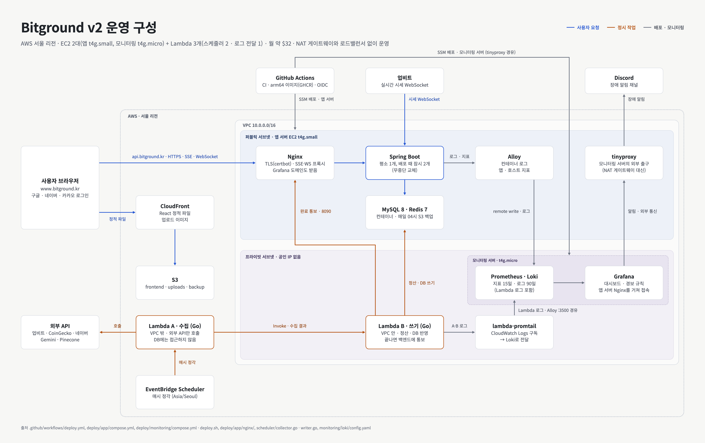
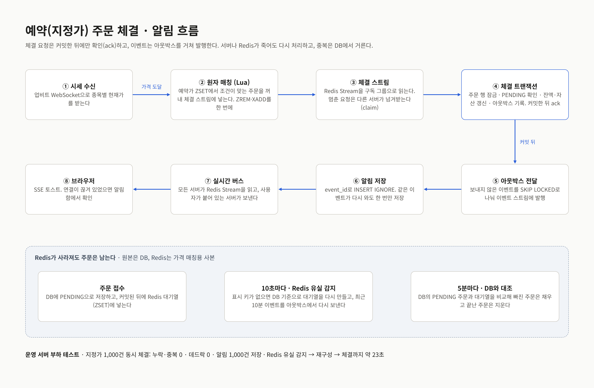
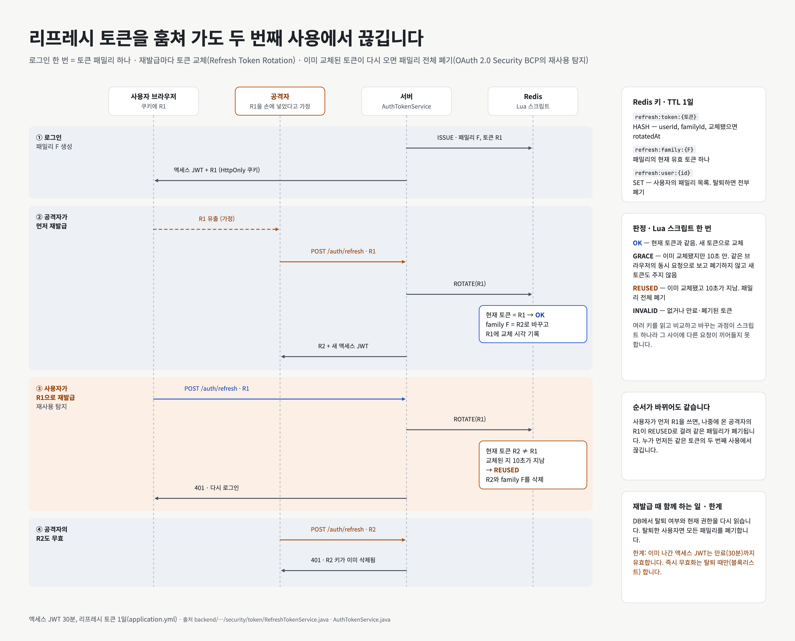
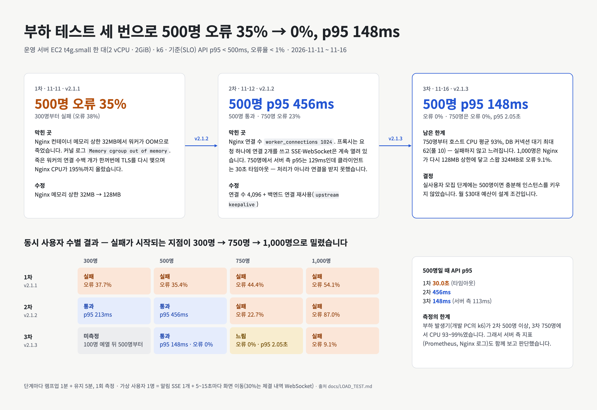
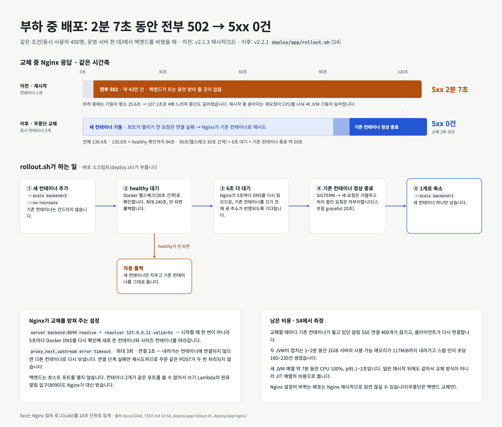
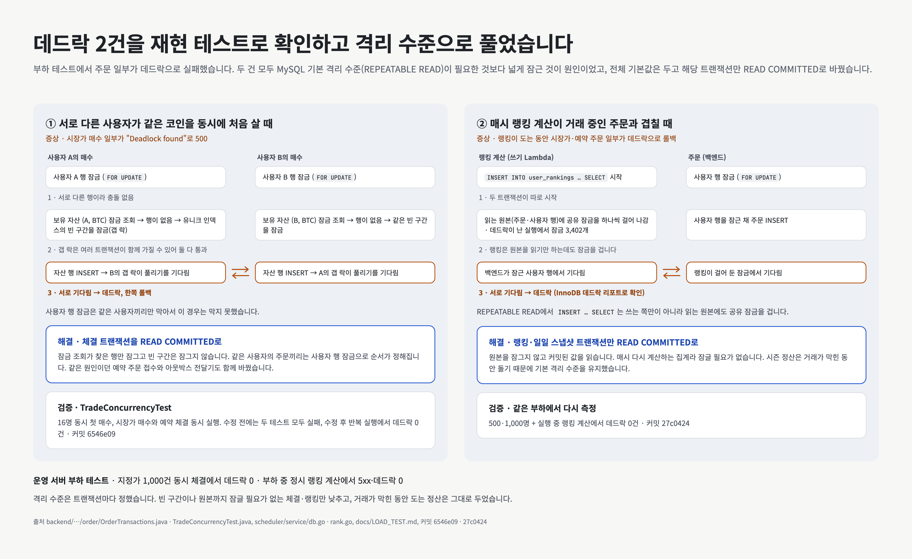
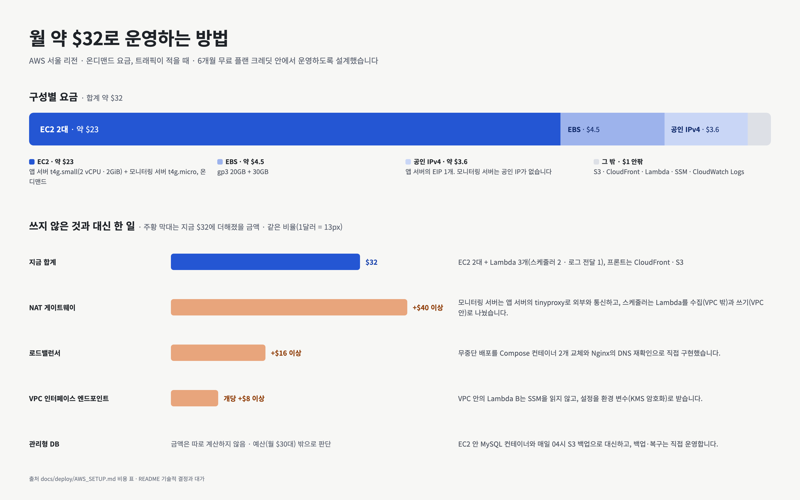
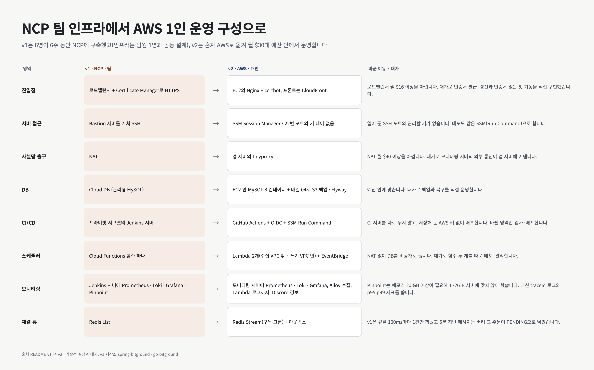

# Bitground

가상화폐 모의투자 서비스입니다. 실제 업비트 시세로 가상 자금을 사고팔고, 시즌마다 수익률 랭킹을 겨룹니다.

**https://www.bitground.kr** · 구글·네이버·카카오 계정으로 바로 로그인

[핵심 수치](#핵심-수치) · [아키텍처](#아키텍처) · [v1 → v2](#v1--v2-같은-문제를-두-번-풀었습니다) · [부하 테스트](#부하-테스트와-운영-개선) · [결정과 대가](#기술적-결정과-대가) · [역할](#역할) · [문서](#저장소-구성과-문서) · [다이어그램 15장](docs/DIAGRAMS.md)

이 저장소는 6인 팀 프로젝트(v1)를 혼자 다시 설계·운영한 **v2**입니다. v1에서 맡았던 부분(로그인·알림·예약 주문·스케줄러·모니터링)의 한계를 직접 찾아 고쳤고, AWS에 올려 운영하면서 부하 테스트로 한계를 확인했습니다.

| | v1 (팀) | v2 (이 저장소, 개인) |
|---|---|---|
| 기간 | 2025-05 ~ 07, 6주 · 6명 | 2026-11-02 ~ (운영 중) |
| 클라우드 | NCP (로드밸런서, NAT, 관리형 DB, Jenkins) | AWS (EC2 2대 + Lambda 3개, 월 약 $32) |
| 저장소 | [spring](https://github.com/lepe99/spring-bitground) · [react](https://github.com/lepe99/react-bitground) · [go](https://github.com/lepe99/go-bitground) | 모노레포 (`backend` · `frontend` · `scheduler` · `deploy` · `monitoring` · `loadtest`) |

## 핵심 수치

| | |
|---|---|
| 동시 사용자 500명 | API p95 **148ms**, 오류 **0%** (운영 서버 EC2 t4g.small 한 대, k6) |
| 부하 중 배포 | 백엔드 재시작 시 **2분 7초 전부 502** → 무중단 교체 후 **5xx 0건** |
| 지정가 1,000건 동시 체결 | 누락·중복 **0**, 데드락 **0**, 알림 1,000건 모두 저장 |
| 운영비 | 월 약 **$32** (NAT 게이트웨이·로드밸런서 없이) |
| 테스트 | 백엔드 JUnit 207개(Testcontainers MySQL·Redis), 스케줄러 Go 52개 |

상세: [부하 테스트 보고서](docs/LOAD_TEST.md)

## 아키텍처

- **앱 서버**(퍼블릭 서브넷): Nginx(TLS) → Spring Boot → MySQL·Redis를 Docker Compose로 운영합니다. 배포 때는 새 백엔드 컨테이너를 먼저 띄우고, healthy가 되면 이전 컨테이너를 정상 종료합니다.
- **모니터링 서버**(프라이빗 서브넷): Prometheus·Loki·Grafana를 둡니다. NAT 대신 앱 서버의 tinyproxy를 거쳐 외부와 통신합니다.
- **스케줄러**: 외부 API를 부르는 수집 Lambda는 VPC 밖, DB에 쓰는 Lambda는 VPC 안에 두어 NAT 없이 DB를 비공개로 유지합니다. 두 Lambda의 로그는 전달용 Lambda가 Loki로 보냅니다.
- **배포**: GitHub Actions가 테스트 → arm64 이미지(GHCR) → OIDC로 AWS 권한을 받아 SSM Run Command로 배포 → 성공하면 태그·Release를 만듭니다. 마지막 릴리즈 이후 바뀐 영역(백엔드·서버 설정·스케줄러·프론트·모니터링 서버)만 검사·배포합니다. 단계는 [CI/CD 그림](docs/DIAGRAMS.md#cicd-파이프라인)에 있습니다.

### 예약(지정가) 주문 체결

원본은 DB의 PENDING 주문이고, Redis는 가격 매칭용 사본입니다. 체결 요청은 커밋한 뒤에만 확인(ack)하고 이벤트는 아웃박스를 거쳐 발행하므로, 서버나 Redis가 죽어도 다시 처리하고 중복은 DB에서 걸러 냅니다.

## v1 → v2: 같은 문제를 두 번 풀었습니다

v1에서 제가 구현했던 기능을 다시 점검해 찾은 한계와 v2의 해법입니다. 항목마다 근거 커밋과 테스트, 그림을 달았습니다.

### 1. 예약 주문 체결
- **v1**: 시세를 100ms마다 Redis에 일괄 저장(MSET)하고 Sorted Set으로 체결할 주문을 찾아 Redis List 큐로 처리했습니다.
- **찾은 한계**: 큐를 100ms마다 1건만 꺼냈고, 5분 지난 메시지는 버려서 그 주문이 PENDING으로 영영 남았습니다. 일괄 저장한 시세는 **읽는 곳이 없었습니다** — 최적화로 발표했던 부분이 실제로는 필요 없는 쓰기였습니다.
- **v2**: Lua로 대기열에서 꺼내기와 스트림에 넣기를 한 번에 처리하고, Redis Stream 구독 그룹으로 읽어 커밋 뒤에 확인합니다. Redis 데이터가 사라지면 10초 안에 감지해 DB 기준으로 다시 만듭니다. 체결 이벤트는 아웃박스로 발행합니다.
- **검증**: 통합 테스트, 운영 서버에서 1,000건 동시 체결(누락·중복 0, Redis 유실 → 재구성 → 체결 약 23초).
- **근거**: 커밋 [0a43fdc](https://github.com/lepe99/bitground/commit/0a43fdc) · [add7827](https://github.com/lepe99/bitground/commit/add7827), 테스트 [ReservedOrderFlowTest](backend/src/test/java/bit/bitgroundspring/order/ReservedOrderFlowTest.java) · [EventPipelineTest](backend/src/test/java/bit/bitgroundspring/order/EventPipelineTest.java), 그림은 [위의 체결 흐름](#예약지정가-주문-체결)

### 2. 정시 스케줄러 (Go)
- **v1**: 정시 작업을 Spring 서버에서 NCP Cloud Functions(Go)로 옮기고 정산 단계들을 고루틴으로 동시에 실행했습니다. 실행 시간은 자정 43초(Gemini 포함), 새벽 3시 3초 이내(콜드 스타트 포함)였습니다.
- **찾은 한계**: 정산 5단계가 각자 트랜잭션이라 하나가 실패하면 반쯤 정산된 채 남았고, 재시도하면 현금이 중복 지급될 수 있었습니다. 임시 테이블을 DROP/CREATE해서 실행이 겹치면 서로 지웠습니다.
- **v2**: 단일 트랜잭션 순차 실행 + `scheduler_runs`로 같은 기간은 한 번만, 순위 계산은 윈도 함수 한 번으로 바꿨습니다. 동시성으로 얻은 속도보다 정합성을 택했습니다. Lambda를 수집/쓰기로 나눠 NAT 비용 없이 DB를 비공개로 두었습니다.
- **근거**: 커밋 [4f05885](https://github.com/lepe99/bitground/commit/4f05885) · [0749c83](https://github.com/lepe99/bitground/commit/0749c83) · [38aea34](https://github.com/lepe99/bitground/commit/38aea34), 통합 테스트 [main_test.go](scheduler/main_test.go)(커밋 [328f423](https://github.com/lepe99/bitground/commit/328f423)) · [season_test.go](scheduler/service/season_test.go), 그림 [시즌 정산 v1 대 v2](docs/DIAGRAMS.md#시즌-정산-v1-대-v2) · [Lambda 분리](docs/DIAGRAMS.md#스케줄러-lambda-분리)

### 3. 알림 (SSE)
- **v1**: SSE + 자동 재연결 + DB 저장. 공지·시즌 알림은 1번 사용자를 전체 알림용 더미 계정으로 두고 그 행에 모아 모두가 함께 읽게 했습니다.
- **찾은 한계**: 더미라는 전제가 코드나 스키마에 없고 데이터로만 존재해, 1번이 실제 가입자인 v2 운영 DB에서는 **그 사람의 체결 알림이 모든 사용자에게 보였습니다.** 읽음 여부도 1번 행 하나를 같이 써서 읽지 않은 개수에 잡히지 않았고, 비로그인 상태에서도 재연결을 몇 초에 100번 넘게 반복했습니다.
- **v2**: 사용자별 저장과 지난 알림 백필, 로그인했을 때만 연결하고 지수 백오프로 재연결합니다. 알림은 먼저 저장하고 커밋 뒤에 보내며, 여러 서버 중 사용자가 붙어 있는 서버가 보냅니다. 배포로 SSE가 끊겨도 알림은 알림함에 남습니다.
- **근거**: 커밋 [293127d](https://github.com/lepe99/bitground/commit/293127d) · [8391394](https://github.com/lepe99/bitground/commit/8391394), 테스트 [UserSseEmittersTest](backend/src/test/java/bit/bitgroundspring/notification/UserSseEmittersTest.java) · [NotificationApiTest](backend/src/test/java/bit/bitgroundspring/api/NotificationApiTest.java), 그림 [알림 v1 대 v2](docs/DIAGRAMS.md#알림-v1-대-v2)

### 4. 인증
- **v1**: OIDC 소셜 로그인 + JWT 쿠키 + 리프레시 토큰 교체(RTR).
- **찾은 한계**: 탈퇴해도 리프레시 토큰이 남아 계속 재발급됐고, 관리자 권한을 회수해도 반영되지 않았습니다.
- **v2**: 로그인 단위 토큰 패밀리, 이미 교체된 토큰을 다시 쓰면 패밀리 전체 폐기(재사용 탐지), 재발급 때 DB 상태·현재 권한을 확인합니다. Lua로 여러 키를 원자적으로 바꿉니다. 통합 테스트는 8개입니다.
- **근거**: 커밋 [b577de4](https://github.com/lepe99/bitground/commit/b577de4), 테스트 [AuthTokenTest](backend/src/test/java/bit/bitgroundspring/auth/AuthTokenTest.java)

### 그 밖에
- **모니터링**: v1에서는 Pinpoint로 팀원 코드의 랭킹 툴팁 API를 찾아 **900ms대 → 11ms**로 줄였습니다(지연 로딩 + 쿼리 수정). v2 서버(2GiB)에는 Pinpoint가 맞지 않아 빼고, traceId 구조화 로그(Java·Go)와 Lambda 로그까지 Loki로 모으고 Discord로 경보를 받습니다.
- **보안**: 요청 본문의 userId를 믿던 커뮤니티 API(작성자 위조·남의 글 삭제), 저장형 XSS, 누구나 전체 알림을 보낼 수 있던 API를 막고 요청 횟수 제한을 넣었습니다.
- **데이터**: 가격·수량을 float → DECIMAL로, 현금을 INT(약 21억에서 넘침) → BIGINT로 바꾸고, 스키마는 Flyway 마이그레이션으로 관리합니다. 테이블 구조는 [ERD](docs/DIAGRAMS.md#전체-erd)에 있습니다.

## 부하 테스트와 운영 개선

운영 서버 한 대가 몇 명까지 버티는지, 무엇이 먼저 막히는지를 측정 → 원인 → 수정으로 세 번 반복했습니다.

| 회차 | 500명 | 막힌 곳 | 수정 |
|---|---|---|---|
| 1차 | 오류 35% | Nginx 메모리 상한 32MB → 워커 OOM | 128MB |
| 2차 | p95 456ms | Nginx 연결 수 1,024 (750명 오류 23%) | 4,096 + 백엔드 연결 재사용 |
| 3차 | **p95 148ms, 오류 0%** | 750명부터 CPU 93%·DB 커넥션 대기 — 느려지지만 실패하지 않음 | 현재 규모에선 유지 |

- **부하 중 장애 주입**(400명): Redis 재시작은 오류가 0이었습니다. 백엔드 재시작은 2분 7초 동안 전부 502였고, **무중단 교체**를 만들어 같은 조건에서 5xx 0건이 됐습니다. 남은 비용(두 JVM이 겹치는 동안의 메모리, 약 7분의 JIT 예열)도 측정해 적었습니다.

- **데드락 2건**: 동시 첫 매수의 갭 락(재현 테스트로 수정 전 실패 확인 → READ COMMITTED), 랭킹 집계와 주문의 공유 잠금 충돌을 해결했습니다. 정산만 기본 격리 수준을 유지했습니다. 근거: 커밋 [6546e09](https://github.com/lepe99/bitground/commit/6546e09) · [27c0424](https://github.com/lepe99/bitground/commit/27c0424), 테스트 [TradeConcurrencyTest](backend/src/test/java/bit/bitgroundspring/order/TradeConcurrencyTest.java)

- **관측 경로**: 1차에서 Nginx가 죽자 Grafana도 함께 열리지 않았습니다. 관측 경로가 서비스와 함께 멈춘다는 것을 확인했고, 앱 서버를 거치지 않는 경보가 다음 과제입니다. 경로는 [관측성 그림](docs/DIAGRAMS.md#관측성-경로)에 있습니다.

## 기술적 결정과 대가

| 결정 | 이유 | 대가 |
|---|---|---|
| NAT 게이트웨이·로드밸런서 미사용 | 월 $40+, $16+로 전체 예산(월 $30대)을 넘음 | 프라이빗 서버는 tinyproxy 경유, 무중단 배포는 Compose + Nginx DNS 재확인으로 직접 구현 |
| 스케줄러 Lambda 2단계 | VPC 안 Lambda가 외부 API를 부르려면 NAT가 필요 | Lambda 두 개를 따로 배포·관리 |
| MySQL 컨테이너 + S3 백업 | 관리형 DB 비용 (월 $30대 예산) | 백업·복구를 직접 운영 |
| Pinpoint 제거 | 메모리 2.5GB 이상이 필요해 1~2GiB 서버에 맞지 않음 | 트랜잭션 추적 대신 traceId 로그 + p95/p99 지표 |
| Caddy → Nginx | 실무에서 더 많이 쓰이는 도구를 직접 설정해 보려고 | Caddy가 해 주던 인증서 발급·갱신, 인증서 없는 첫 기동을 직접 구현(certbot, entrypoint) |

## 역할

**v1 (팀 6명)** — 로그인(OIDC·JWT·RTR), SSE 알림, 예약(지정가) 주문 접수·체결 로직, 정시 스케줄러와 서버리스 이관(Go), 모니터링(Prometheus·Loki·Grafana·Pinpoint), REST API 규약, React 라우팅·전역 상태. 클라우드 인프라는 팀원 한 명과 공동으로 설계·구축했습니다. 시장가 매매와 거래소 화면, 투자내역·랭킹·커뮤니티·AI 기능 등은 다른 팀원이 맡았습니다.

**v2 (개인)** — 모노레포 통합, 전 영역 점검·수정, AWS 설계·구축·운영, CI/CD, 부하 테스트.

### AI 활용 방식
v2는 Claude Code와 함께 작업했습니다. AI가 코드 전체를 넓게 점검하고, 사람이 정해야 할 항목(기능 범위, 비용과 구조의 맞교환 등)은 따로 뽑아 선택지를 비교한 뒤 직접 결정했습니다. 고친 뒤에는 수정 전 코드에서 테스트가 실패하는지, 일부러 값을 바꾸면 실패하는지 확인해 테스트가 실제로 결함을 잡는지 검증했습니다. 서비스 안의 AI 기능(Gemini)은 고정 평가셋과 프롬프트 버전 관리로 품질을 비교합니다([AI 평가셋](docs/AI_EVAL.md)).

## 기술 스택

| 영역 | 사용 기술 |
|---|---|
| Backend | Java 21, Spring Boot 3.4, Spring Security(OAuth2/OIDC, JWT), JPA, Flyway, MySQL 8, Redis 7(Stream·Lua), SSE·WebSocket |
| Scheduler | Go, AWS Lambda, EventBridge, Gemini API |
| Frontend | React 19, Vite, React Router |
| Infra | AWS EC2(Graviton), Lambda, S3, CloudFront, SSM, Docker Compose, Nginx, certbot |
| CI/CD | GitHub Actions, GHCR, OIDC, SSM Run Command |
| Observability | Grafana Alloy, Prometheus, Loki, Grafana, Discord 경보 |
| Test | JUnit 5, Testcontainers, Go test, k6 |

## 저장소 구성과 문서

| 경로 | 내용 |
|---|---|
| `backend/` | Spring Boot API · 주문 체결 · 알림 |
| `frontend/` | React 화면 |
| `scheduler/` | Go 정시 작업 (Lambda 수집·쓰기) |
| [`deploy/`](deploy/README.md) | 운영 서버 구성 (Compose, Nginx, 무중단 교체, 백업) |
| `monitoring/` | Prometheus·Loki·Grafana 설정 |
| [`loadtest/`](loadtest/README.md) | k6 부하 테스트 스크립트 |
| [`docs/LOAD_TEST.md`](docs/LOAD_TEST.md) | 부하 테스트 보고서 |
| [`docs/DIAGRAMS.md`](docs/DIAGRAMS.md) | 다이어그램 15장 (구성·흐름·v1 대 v2·ERD) |
| [`docs/API.md`](docs/API.md) | API 응답 규약 (RFC 9457 Problem Details) |
| [`CHANGELOG.md`](CHANGELOG.md) | 릴리즈 기록 |

로컬 실행: 각 폴더의 `.env.example`을 `.env`로 복사해 값을 채운 뒤 `docker compose --profile app up -d --build`를 실행합니다. 프론트는 `frontend`에서 `npm run dev`로 띄웁니다.
