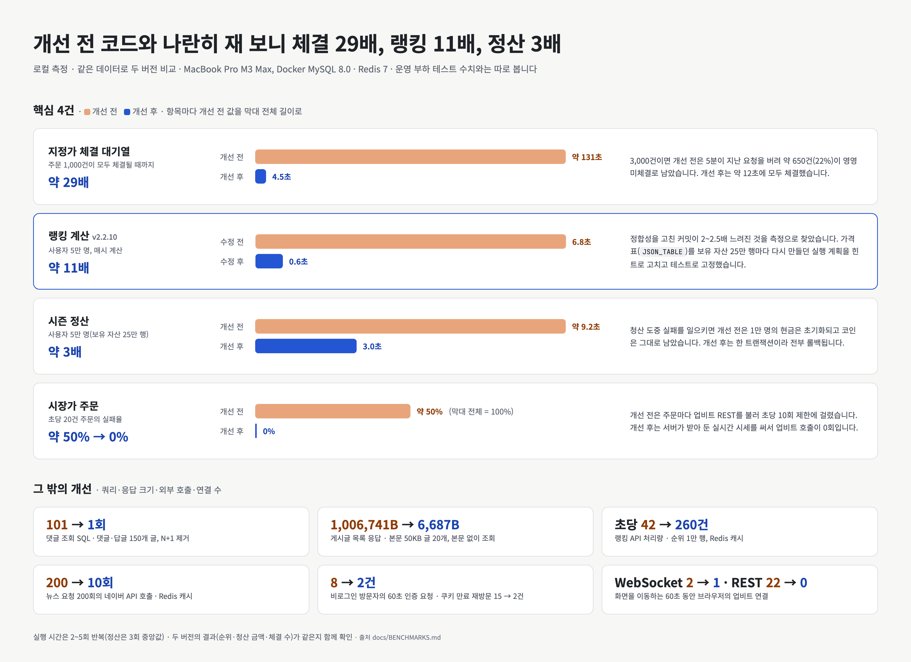

# 개선 전/후 측정

[← README로 돌아가기](../README.md)

성능이나 안정성을 고친 커밋마다 고치기 전 코드와 고친 뒤 코드를 같은 환경에서 실행해 비교했습니다. 커밋 메시지에 적은 효과가 실제로 나는지 확인하려는 측정이었고 그 과정에서 오히려 느려진 커밋 하나를 찾아 고쳤습니다(아래 [랭킹 계산](#2-랭킹-계산-측정으로-찾은-회귀와-수정)).

## 요약

| 항목 | 개선 전 → 후 | 잰 방법 |
|---|---|---|
| 지정가 체결 대기열 | 1,000건 체결 **약 131초 → 4.5초**(약 29배), 3,000건이면 개선 전은 **약 650건이 영영 미체결** → 0건 | 마지막 주문이 체결될 때까지의 시간, DB의 남은 PENDING 수 |
| 랭킹 계산 (v2.2.10) | 사용자 5만 명 매시 **6.8초 → 0.6초**, 0시 **14.3초 → 1.3초**(약 11배), 순위 동일 | 같은 시드 DB에서 실행 시간, `EXPLAIN ANALYZE` |
| 시즌 정산 | 사용자 5만 명 **약 9.2초 → 3.0초**(3회 중앙값), 결과 동일 / 중간 실패 시 개선 전은 **1만 명이 반쯤 정산된 채 남음** → 전부 롤백 | 실행 시간, 결과 테이블 비교, 실패 주입 |
| 시장가 주문 | 초당 20건에서 실패율 **약 50% → 0%**, 주문당 업비트 호출 1회 → 0회 | 일정 속도로 주문을 보내 HTTP 상태별 건수 집계 |
| 댓글 조회 | 댓글·답글 150개 글에서 SQL **101회 → 1회**, p50 27.3ms → 6.7ms | Hibernate 통계 |
| 게시글 목록 | 응답 크기 **1,006,741B → 6,687B**(본문 50KB 글 20개) | 응답 바이트 수 |
| 랭킹 API 캐시 | 순위 1만 행 처리량 **초당 42 → 260건**, 요청당 SQL 1회 → 0회 | 20명 동시 요청 |
| 뉴스 캐시 | 같은 요청 200회에 네이버 API 호출 **200회 → 10회** | 가짜 API의 호출 수 |
| 비로그인 방문 | 60초 동안 인증 관련 요청 **8건 → 2건**(쿠키 만료 재방문 15건 → 2건) | 헤드리스 브라우저 + 요청을 세는 가짜 백엔드 |
| 업비트 연결 | 화면 이동 60초 동안 WebSocket **2개 → 1개**, REST **22회 → 0회** | 헤드리스 브라우저의 네트워크 이벤트 |

모든 수치는 **로컬 측정**입니다. 운영 서버에서 잰 [부하 테스트](LOAD_TEST.md) 수치와는 환경이 달라 섞지 않습니다.

## 측정 원칙

- **비교 대상**: 개선 커밋의 바로 앞 커밋과 개선 커밋을 비교하는 것이 원칙입니다. 그래야 다른 변경이 섞이지 않습니다. 1·4번은 개선이 여러 커밋에 걸쳐 있어 측정 시점의 최신 코드([582ef58](https://github.com/lepe99/bitground/commit/582ef58))와 비교했고, 8번은 바로 앞 커밋이 실행되지 않아 그 앞 커밋과 비교했습니다. `git archive`로 그 시점 코드를 꺼내 측정용 테스트만 넣었고 저장소 코드는 바꾸지 않았습니다.
- **왜 로컬인가**: 개선 전 코드는 운영에 다시 올릴 수 없습니다. 같은 머신·같은 DB 이미지·같은 데이터에서 두 버전을 번갈아 돌려 상대 비교만 합니다. 그래서 "몇 배", "몇 회 → 몇 회"로 말합니다.
- **환경**: MacBook Pro M3 Max, Docker Desktop(VM 16 CPU · 8GB), `mysql:8.0`(운영과 같은 이미지), `redis:7-alpine`, JDK 21, Go 1.26 컨테이너
- **반복**: 실행 시간을 재는 1~4번은 같은 조건을 2~5회 반복해 회마다 값이 일관되는지 확인했고 표에는 각 회의 값이나 범위, 중앙값을 적었습니다. 5·6번은 버전마다 한 번 실행하면서 예열 뒤 요청 50~100회의 p50·p95를 냈습니다. 백엔드는 실행할 때마다 JVM을 새로 띄웠습니다.
- **결과가 같은지 확인**: 빨라졌지만 결과가 틀린 경우를 걸러 내려고 순위·티어, 청산 건수·금액, 체결 수·남은 주문 수를 두 버전에서 비교했습니다.
- **외부 API**: 서버가 부르는 업비트·네이버는 가짜 서버로 바꿨고 지연과 제한은 근거가 있는 값만 썼습니다(브라우저 연결을 센 8번만 실제 업비트 공개 API에 연결). 업비트 응답 15ms는 같은 Mac에서 실제 업비트에 요청해 잰 값이고 초당 10회는 업비트 문서의 시세 조회 제한입니다. 근거가 없는 네이버는 시간을 재지 않고 호출 수만 셌습니다.

## 1. 지정가 체결 대기열

비교: [b577de4](https://github.com/lepe99/bitground/commit/b577de4) → [582ef58](https://github.com/lepe99/bitground/commit/582ef58) (핵심 변경 [b03967d](https://github.com/lepe99/bitground/commit/b03967d))

개선 전에는 체결 요청을 Redis 리스트에 넣고 100ms마다 1건씩 꺼냈으며 5분이 지난 요청은 버렸습니다. 지금은 시세 1건마다 조건에 맞는 주문을 최대 200건 꺼내 Redis Stream으로 넘기고 한 번에 최대 500건을 처리합니다.

**잰 방법**
1. 사용자 N명이 각자 BTC 매수 지정가 5,000만 원을 실제 주문 서비스로 접수했습니다.
2. 4,900만 원 시세를 100ms마다 보냈습니다. 각 버전의 실제 매칭 코드를 불렀고 체결은 각 버전의 스케줄러가 처리했습니다.
3. DB에서 COMPLETED 주문 수를 계속 세어 마지막 체결까지의 시간과 남은 PENDING 수를 기록했습니다. 버전마다 3회씩 쟀습니다.

시세를 처음에는 한 번만 보냈는데 지금 코드는 시세 1건당 200건까지만 꺼내므로 1,000건 중 200건만 체결됐습니다. 실제 BTC 시세는 1초에 여러 번 오므로 두 버전 모두 100ms마다 보내도록 바꿨습니다. 개선 전 코드는 첫 시세에 주문을 모두 꺼내므로 이 변경이 개선 전에 불리하지 않습니다.

| 주문 수 | 버전 | 마지막 체결까지 (3회) | 처리량 | 체결 / 남은 PENDING |
|---|---|---|---|---|
| 1,000 | 개선 전 | 130.9 · 132.4 · 131.5초 | 초당 7.6~7.7건 | 1,000 / 0 |
| 1,000 | 개선 후 | 4.6 · 4.5 · 4.4초 | 초당 223~236건 | 1,000 / 0 |
| 3,000 | 개선 전 | 302.6~302.9초에서 멈춤 | 초당 7.8~7.9건 | 2,347~2,357 / **643~653** |
| 3,000 | 개선 후 | 12.0 · 12.3 · 12.2초 | 초당 246~252건 | 3,000 / 0 |

- 개선 전 처리량이 이론값(초당 10건)보다 낮은 것은 `fixedDelay = 100`이 "이전 실행이 끝난 뒤 100ms"이기 때문입니다.
- 3,000건에서 개선 전은 5분이 지나자 남은 요청을 버려 약 650건(22%)이 PENDING으로 남았습니다. 이 주문들은 대기열에서 이미 빠져 다음 시세가 와도 다시 매칭되지 않습니다.
- 로컬에는 네트워크 지연이 없어 개선 후 처리량이 운영 부하 테스트의 체결 처리량(초당 69건)보다 높습니다.

## 2. 랭킹 계산: 측정으로 찾은 회귀와 수정

비교: [4f05885](https://github.com/lepe99/bitground/commit/4f05885) → [0749c83](https://github.com/lepe99/bitground/commit/0749c83), 수정은 [10895b5](https://github.com/lepe99/bitground/commit/10895b5) → [9b2929f](https://github.com/lepe99/bitground/commit/9b2929f) (v2.2.10)

[0749c83](https://github.com/lepe99/bitground/commit/0749c83)은 사용자마다 INSERT하던 랭킹 계산을 SQL 한 번으로 바꾼 커밋입니다. 목적은 정합성(임시 테이블 DROP/CREATE 경합, Lambda에 남는 전역 상태 제거)이었지만 쿼리 수가 줄어 빨라졌을 것으로 예상하고 쟀습니다. 결과는 반대였습니다.

**잰 방법**
1. MySQL 8.0에 그 시점 스키마를 넣고 코인 50개, 사용자 N명(사용자마다 체결 주문 1건, 보유 코인 5종)을 만들었습니다. 두 커밋의 스키마가 같아 계산 방식의 차이만 비교됩니다.
2. Go 테스트에서 각 버전의 `UpdateRank`를 그대로 호출했습니다. 업비트 시세 조회만 고정 가격을 주는 가짜로 바꿨습니다.
3. 예열 1회 뒤 5회 중앙값을 냈고, 매시 실행과 0시 실행(일일 자산 스냅샷 포함)을 따로 쟀습니다.
4. 실행 뒤 `user_rankings`를 사용자 순으로 덤프해 두 버전의 순위·티어가 같은지 비교했습니다. 모든 조건에서 같았습니다.

| 사용자 | 매시 4f05885 → 0749c83 | 0시 4f05885 → 0749c83 |
|---|---|---|
| 1,000 | 56 → 134ms | 97 → 267ms |
| 10,000 | 495 → 1,281ms | 1,148 → 2,550ms |
| 50,000 | 3,592 → 7,046ms | 5,630 → 14,158ms |

**원인**: 5만 명 데이터에서 총자산 집계 쿼리를 `EXPLAIN ANALYZE`로 보니, 8.5초 중 약 8.1초가 `Materialize table function … loops=250000`이었습니다(`EXPLAIN ANALYZE`는 실행 단계마다 시간을 재므로 표의 실행 시간보다 조금 길게 나옵니다). 가격 50개짜리 `JSON_TABLE`을 보유 자산 25만 행마다 다시 만들고 있었습니다.

**수정**: 가격 표를 담은 CTE에 `NO_MERGE` 옵티마이저 힌트를 넣어 한 번만 만들게 했습니다. `LIMIT`을 붙여도 같은 효과가 났지만 힌트가 의도를 더 분명히 드러냅니다. 힌트가 빠지는 것을 막으려고 `EXPLAIN FORMAT=TREE` 결과에 `Materialize CTE prices`가 있는지 확인하는 테스트([rank_plan_test.go](../scheduler/service/rank_plan_test.go))를 추가했고 힌트를 빼면 이 테스트가 실패하는 것도 확인했습니다.

| 사용자 | 매시 수정 전 → 후 | 0시 수정 전 → 후 |
|---|---|---|
| 1,000 | 134 → 12ms | 267 → 22ms |
| 10,000 | 1,343 → 122ms | 2,658 → 224ms |
| 50,000 | 6,816 → 600ms | 14,333 → 1,270ms |

약 11배 빨라졌고 순위·티어는 같았습니다. 정합성을 고치기 전 코드(5만 명 3.6초 · 5.6초)보다도 빠릅니다. 같은 `JSON_TABLE`을 쓰는 시즌 정산 쿼리는 실행 계획에서 가격 표를 한 번만 만들고 있어(loops=1, 25만 행 100ms) 그대로 뒀습니다.

## 3. 시즌 정산

비교: [09113d2](https://github.com/lepe99/bitground/commit/09113d2) → [4f05885](https://github.com/lepe99/bitground/commit/4f05885)

개선 전에는 정산 단계 5개를 고루틴으로 동시에 돌렸고 단계마다 트랜잭션이 따로였습니다. 개선 후에는 한 트랜잭션에서 순서대로 실행하고 보유 코인 청산을 1,000건씩 나눠 INSERT하던 방식을 `INSERT … SELECT` 한 번으로 바꿨습니다.

**잰 방법**
1. 랭킹과 같은 데이터에 시즌 이름, 이전 시즌 최종 랭킹, 사용자마다 미체결 주문 1건을 더했습니다. 정산은 데이터를 바꾸므로 매 실행 전에 데이터를 다시 넣었습니다.
2. 각 버전의 `UpdateSeason` 호출 전후 시간을 쟀고 버전마다 3회씩 돌렸습니다.
3. 청산 기록 수, 청산 금액 합, 남은 보유 자산, 남은 미체결 주문, 현금이 초기화된 사용자 수, 티어 합, 시즌 상태를 두 버전에서 비교했습니다. 모든 조건에서 같았습니다.

| 사용자 (보유 자산 행) | 개선 전 | 개선 후 |
|---|---|---|
| 1,000 (5,000) | 137~146ms | 73~74ms |
| 10,000 (50,000) | 1,358~1,424ms | 527~539ms |
| 50,000 (250,000) | 9,076~10,923ms | 2,998~3,116ms |

동시 실행을 순차 실행으로 바꿨는데도 2~3배 빨라졌습니다. 청산 단계에서 DB 왕복이 줄어든 효과가 병렬 실행을 포기한 손해보다 컸습니다.

**실패 주입**: 사용자 1만 명에서, MySQL 트리거로 청산 기록을 넣다가 60% 지점에서 에러가 나게 했습니다.

| | 개선 전 | 개선 후 |
|---|---|---|
| 이전 시즌 / 새 시즌 | 완료 처리됨 / 생성됨 | 그대로 / 없음 |
| 현금 초기화 | 10,000명 전원 | 0명 |
| 미체결 주문 삭제 | 10,000건 전부 | 0건 |
| 청산 기록 | 50,000건 중 29,000건 | 0건 |
| 남은 보유 자산 | 50,000건 (지워지지 않음) | 50,000건 (원래대로) |
| 다시 실행 | 불가 (시즌이 이미 완료 상태) | 가능 |

개선 전에는 실패하면 사용자 1만 명이 새 시즌 현금을 받고도 이전 시즌 코인을 그대로 가진 채 남았고 정산을 다시 실행할 수도 없었습니다.

## 4. 시장가 주문의 현재가 확인

비교: [fe8e05e](https://github.com/lepe99/bitground/commit/fe8e05e) → [582ef58](https://github.com/lepe99/bitground/commit/582ef58) (핵심 변경 [0d170f1](https://github.com/lepe99/bitground/commit/0d170f1) · [cfbff89](https://github.com/lepe99/bitground/commit/cfbff89))

개선 전에는 시장가 주문마다 업비트 REST로 현재가를 조회했습니다. 지금은 서버가 WebSocket으로 받아 Redis에 둔 실시간 시세를 씁니다.

**잰 방법**
1. 사용자 300명이 돌아가며 1만 원어치 시장가 매수를 냈습니다. 초당 5·10·20·50건을 각 20초씩 일정 간격으로 보냈습니다. 응답을 기다리지 않고 정해진 시각에 다음 주문을 보내는 오픈 루프(open-loop) 방식입니다.
2. 가짜 업비트 REST는 15ms 뒤 응답하고 같은 초에 10회를 넘으면 429를 돌려주게 했습니다.
3. 개선 후 코드가 실시간 시세를 받는 상태가 되도록 1초마다 Redis에 시세를 기록했습니다.
4. HTTP 상태별 건수와 가짜 업비트 호출 수를 셌고 2회 반복했습니다.

처음에는 한 스레드가 응답을 받자마자 다음 주문을 보내게 했는데 그러면 사용자 1명이 초당 148건을 보내는 셈이라 현실과 맞지 않았습니다. "초당 몇 건부터 실패하는가"를 보려면 들어오는 속도를 고정해야 해서 오픈 루프 방식으로 바꿨습니다.

| 초당 주문 | 개선 전 실패율 | 개선 후 실패율 | 개선 전 업비트 호출 | 개선 후 업비트 호출 |
|---|---|---|---|---|
| 5 | 0% | 0% | 100회 | 0회 |
| 10 | 0% | 0% | 200회 | 0회 |
| 20 | 48.3% · 50.0% | 0% | 400회 (429 193·200회) | 0회 |
| 50 | 79.4% · 79.0% | 0% | 1,000회 (429 794·790회) | 0회 |

- 개선 전 실패율은 가짜 서버의 초당 10회 제한에서 거의 그대로 나오는 값입니다(≈ 1 − 10/초당 주문 수). 그래서 이 표는 "개선 전 구조에서는 서비스 전체 시장가 주문이 초당 약 10건에서 막혔다"는 근거로만 씁니다.
- 낮은 단계부터 차례로 돌려 JVM 예열 효과가 섞였기 때문에 응답 시간의 절댓값은 적지 않았습니다.

## 5. 커뮤니티 조회

비교: [7da88f7](https://github.com/lepe99/bitground/commit/7da88f7) → [070d71a](https://github.com/lepe99/bitground/commit/070d71a)

**잰 방법**: 글 1개에 댓글 50개와 답글 100개, 본문 50KB짜리 글 20개를 넣었습니다. Hibernate 통계(`generate_statistics`)를 켜고 예열 10회 뒤 요청 1회에 실행된 SQL 수를 셌고 이어서 50회 요청해 응답 시간과 응답 크기를 쟀습니다. 버전마다 한 번 실행했습니다.

| | 개선 전 | 개선 후 |
|---|---|---|
| 댓글 조회 SQL | 101회 | 1회 |
| 댓글 응답 p50 / p95 | 27.3 / 30.4ms | 6.7 / 8.4ms |
| 목록 응답 크기 | 1,006,741B | 6,687B |
| 목록 응답 p50 / p95 | 13.7 / 18.3ms | 5.0 / 7.2ms |

- 댓글: `@EntityGraph`가 댓글과 답글까지만 함께 가져오고 DTO로 바꿀 때 답글마다 하위 댓글을 다시 조회해 답글 수만큼 쿼리가 나갔습니다(N+1).
- 목록: 이미지가 있는지 판단하려고 쿼리가 본문 전체를 읽었고 그 본문이 응답에도 실렸습니다. 개선 후에는 `has_image` 컬럼을 두고 본문 없이 조회합니다.

## 6. 랭킹·뉴스 Redis 캐시

비교: [dbb71d8](https://github.com/lepe99/bitground/commit/dbb71d8) → [68b5751](https://github.com/lepe99/bitground/commit/68b5751)

**잰 방법**: 진행 중인 시즌에 순위 N행을 넣고 `GET /rank/current`를 1명이 100회 호출해 응답 시간을 쟀고 20명이 동시에 모두 2,000회(1만 행은 300회) 호출해 처리량과 SQL 수를 쟀습니다. 버전마다 한 번 실행했습니다. 뉴스는 검색어 5개 × 페이지 2개를 돌아가며 200회 요청하고 가짜 네이버 API의 호출 수를 셌습니다.

| 순위 행 | 응답 크기 | p50 전 → 후 | 처리량 전 → 후 | 부하 중 SQL 전 → 후 |
|---|---|---|---|---|
| 1,000 | 178KB | 12.7 → 4.8ms | 초당 763 → 2,255건 | 2,000 → 0회 |
| 10,000 | 1.8MB | 89.3 → 29.5ms | 초당 42 → 260건 | 300 → 0회 |

- 캐시에서 읽어도 Redis 왕복과 1.8MB 역직렬화 비용이 있어서 DB 조회보다 실제로 빠른지 확인하려고 쟀습니다.
- 개선 전 버전이 메모리 부족으로 멈춰 두 버전 모두 테스트 힙을 2GB로 똑같이 올렸습니다. 1만 행은 처음에 2,000회로 설계했으나 개선 전이 10분 넘게 끝나지 않아 두 버전 모두 300회로 줄였습니다.
- 뉴스는 네이버의 실제 응답 시간을 알 수 없어 시간은 재지 않았고 호출 수는 200회에서 10회로 줄었습니다.

## 7. 비로그인 방문자의 알림 연결

비교: [aa13753](https://github.com/lepe99/bitground/commit/aa13753) → [8391394](https://github.com/lepe99/bitground/commit/8391394)

개선 전에는 로그인하지 않은 방문자도 알림 SSE 연결을 시도했고 401을 받으면 재연결과 토큰 재발급을 반복했습니다.

**잰 방법**: 인증이 필요한 경로에 401을 응답하고 들어온 요청을 세는 가짜 백엔드를 띄웠습니다. 두 버전의 프론트를 헤드리스 Chromium으로 메인 화면에서 60초 열어 두고 백엔드 쪽에서 요청 수를 셌습니다. 버전마다 한 번씩, 처음 온 방문자와, 예전에 로그인했지만 쿠키가 만료된 재방문자 두 경우를 쟀습니다.

| 60초 동안 인증 관련 요청 | 개선 전 | 개선 후 |
|---|---|---|
| 처음 온 방문자 | 8건 (SSE 구독 6, 알림 수 1, 재발급 1) | 2건 (로그인 확인 1, 재발급 1) |
| 쿠키가 만료된 재방문자 | 15건 (SSE 7, 재발급 4, 로그아웃 2 등) | 2건 |

## 8. 브라우저의 업비트 연결

비교: [058f4c0](https://github.com/lepe99/bitground/commit/058f4c0) → [873d53d](https://github.com/lepe99/bitground/commit/873d53d)

바로 앞 커밋([21bf302](https://github.com/lepe99/bitground/commit/21bf302))은 지운 파일을 다른 파일이 아직 불러오고 있어 프론트가 실행되지 않았습니다. 그래서 그 앞 커밋과 비교했습니다.

**잰 방법**: 비로그인 상태로 메인(20초) → 최신 동향(20초) → 메인(20초) 순서로 새로고침 없이 앱 안에서 이동했습니다. 업비트는 실제 공개 API에 연결했고 Playwright의 네트워크 이벤트로 WebSocket과 REST 요청을 셌습니다. 2회 반복해 결과가 같았습니다.

| 60초 동안 | 개선 전 | 개선 후 |
|---|---|---|
| 업비트 WebSocket | 2개 | 1개 |
| 업비트 REST | 22회 | 0회 |

## 측정의 한계

- 반복 횟수가 적어(실행 시간은 2~5회, 5~7번은 버전마다 한 번) 통계적으로 엄밀한 수준은 아닙니다. 대신 개선 전후 차이가 반복 사이의 흔들림보다 훨씬 큰 결과만 적었습니다.
- 데이터 분포(코인 50개, 사용자당 보유 코인 5종 등)는 가정한 값입니다. 랭킹 계산은 보유 자산 행이 많을수록 차이가 커지는 구조입니다.
- 시장가 주문 실패율은 가짜 서버의 제한에서 거의 그대로 나오는 값이라 업비트 호출 제한이 상한을 만든다는 근거로만 씁니다.
- 커밋 메시지에 적은 현상 중 두 가지는 로컬에서 재현하지 못했습니다. 비로그인 방문자가 몇 초 만에 100회 넘게 재시도하는 현상과 운영 도메인에서 업비트가 429를 돌려준 현상입니다. 그래서 7·8번에는 측정한 요청·연결 수만 적었습니다.
