# 다이어그램

[← README로 돌아가기](../README.md)

Bitground v2의 구성과 흐름을 그린 그림 15장입니다. README에는 이 중 8장을 넣었고, 여기에는 전부 모았습니다. 모두 아트보드의 2배 해상도로 캡처했습니다. 이미지를 누르면 원본 크기로 볼 수 있습니다.

[구조](#구조) · [흐름](#흐름) · [v1 대 v2](#v1-대-v2) · [문제 해결](#문제-해결) · [데이터](#데이터)

## 구조

### 운영 구성

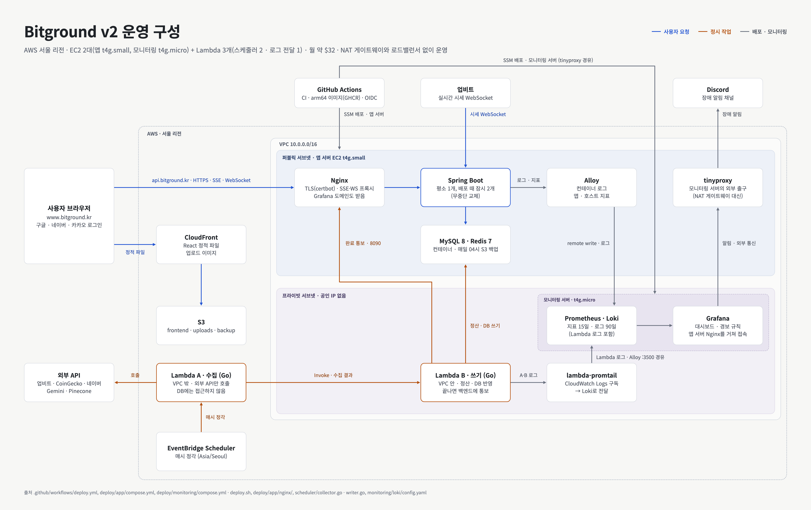

AWS 서울 리전의 EC2 2대와 Lambda 3개(스케줄러 2 · 로그 전달 1)로 운영합니다. NAT 게이트웨이와 로드밸런서 없이 월 약 $32입니다. 서버 구성은 [deploy/README.md](../deploy/README.md)에 있습니다.

### 관측성 경로

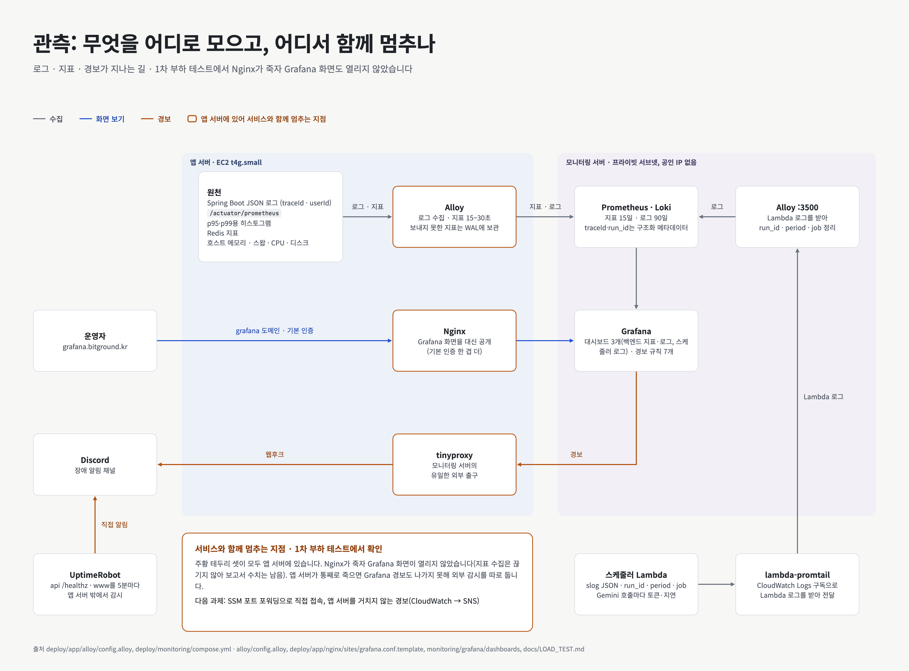

로그·지표·경보가 지나는 길입니다. 1차 부하 테스트에서 Nginx가 죽자 Grafana 화면도 열리지 않아, 앱 서버와 함께 멈추는 지점을 따로 표시했습니다.

### CI/CD 파이프라인

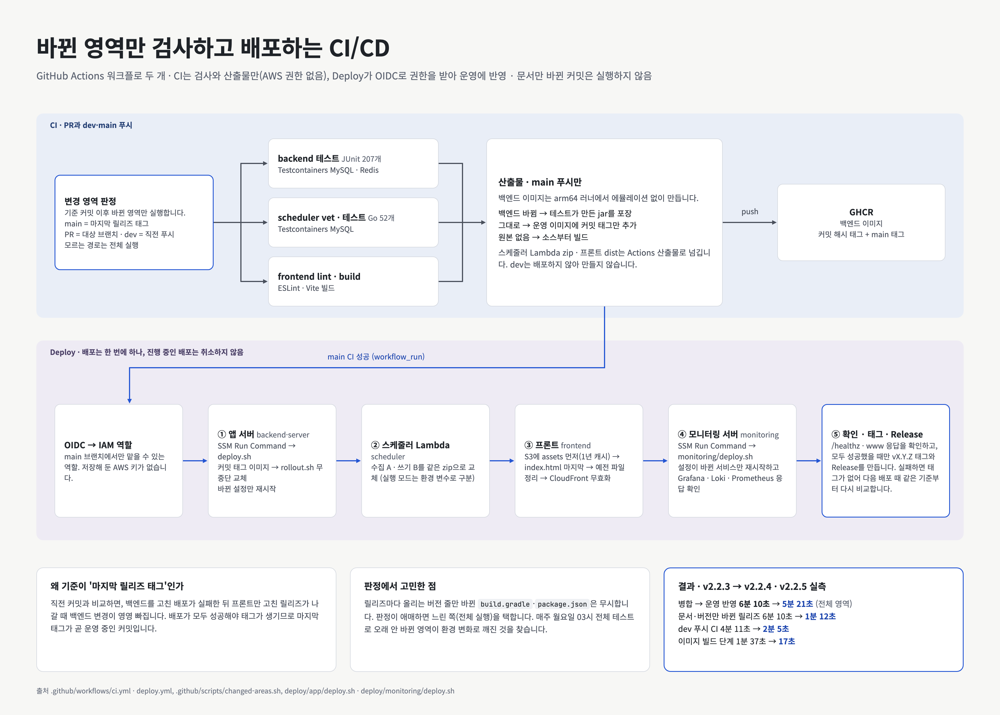

마지막 릴리즈 태그 이후 바뀐 영역만 검사하고 배포합니다. 문서·버전만 바뀐 릴리즈는 병합부터 운영 반영까지 6분 10초에서 1분 12초로 줄었습니다. 워크플로는 [.github/workflows](../.github/workflows)에 있습니다.

### 월 운영비 분해

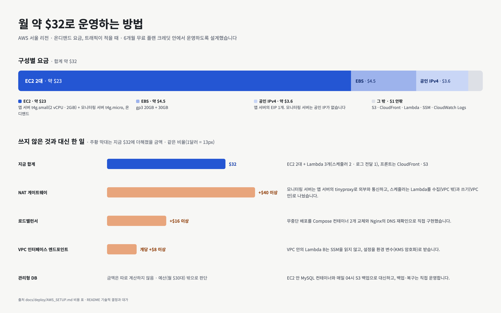

월 약 $32의 구성과, 쓰지 않은 서비스(NAT 게이트웨이·로드밸런서·VPC 인터페이스 엔드포인트·관리형 DB) 대신 직접 구현한 것을 같은 비율의 막대로 그렸습니다.

### 인프라 v1 대 v2

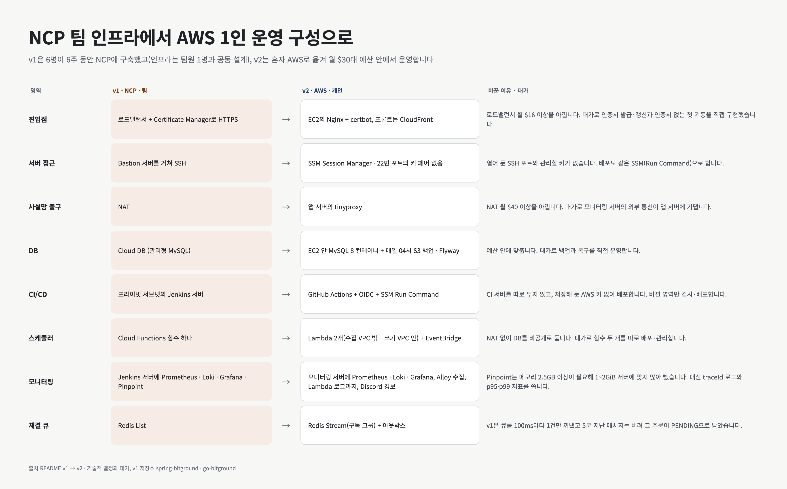

6명이 NCP에 만든 v1과 혼자 AWS로 옮긴 v2를 영역별로 비교하고, 바꾼 이유와 대가를 적었습니다.

## 흐름

### 지정가 체결

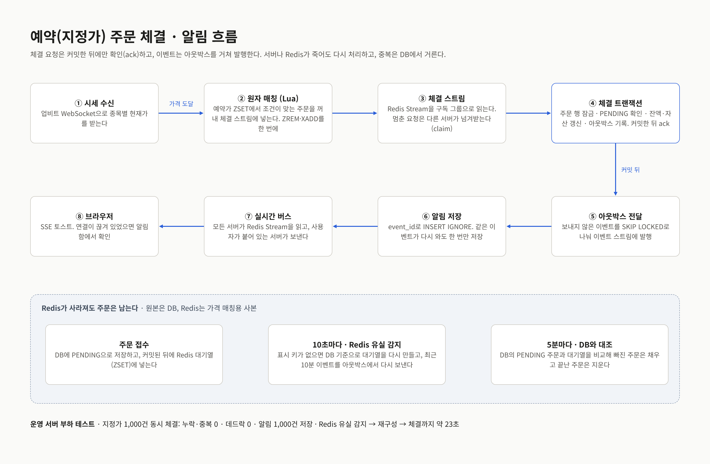

체결 요청은 커밋한 뒤에만 확인(ack)하고 이벤트는 아웃박스를 거쳐 발행합니다. 근거: 커밋 [0a43fdc](https://github.com/lepe99/bitground/commit/0a43fdc) · [add7827](https://github.com/lepe99/bitground/commit/add7827), 테스트 [ReservedOrderFlowTest](../backend/src/test/java/bit/bitgroundspring/order/ReservedOrderFlowTest.java) · [EventPipelineTest](../backend/src/test/java/bit/bitgroundspring/order/EventPipelineTest.java)

### 무중단 배포

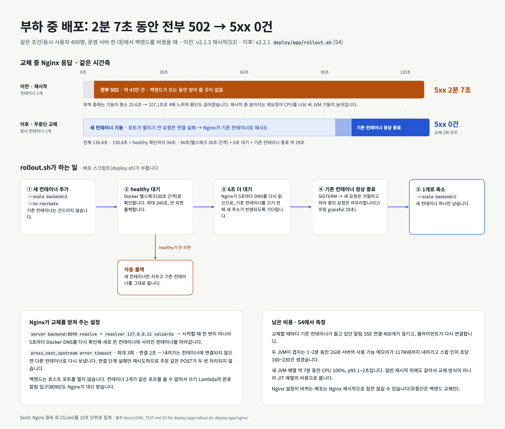

부하 중 백엔드 재시작은 2분 7초 동안 전부 502였고, 컨테이너 2개를 겹쳐 교체하도록 바꾼 뒤 5xx가 0건이었습니다. 근거: [부하 테스트 보고서](LOAD_TEST.md) S3·S4, [rollout.sh](../deploy/app/rollout.sh)

### 리프레시 토큰 재사용 탐지

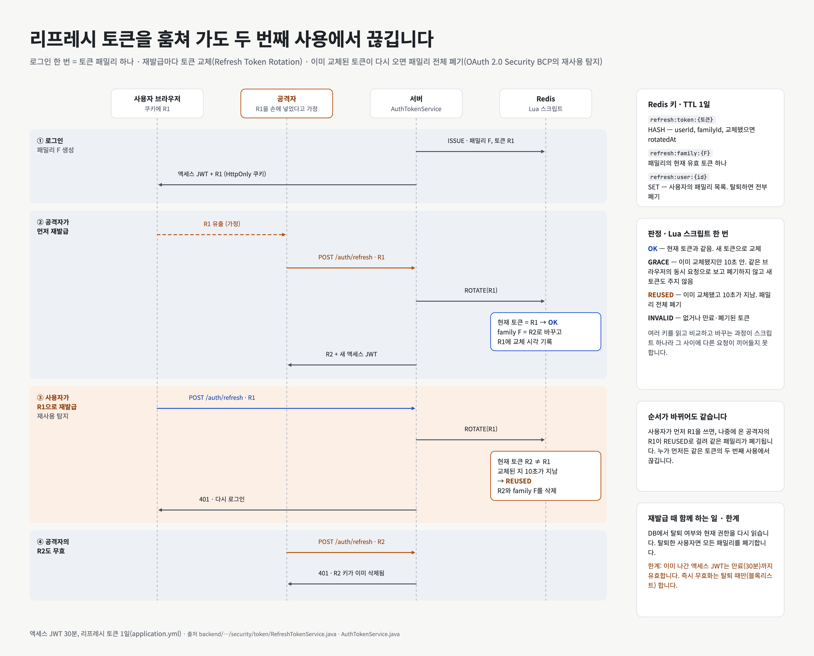

이미 교체된 리프레시 토큰이 다시 오면 그 로그인의 토큰 패밀리 전체를 폐기합니다. 근거: 커밋 [b577de4](https://github.com/lepe99/bitground/commit/b577de4), 테스트 [AuthTokenTest](../backend/src/test/java/bit/bitgroundspring/auth/AuthTokenTest.java)

### 스케줄러 Lambda 분리

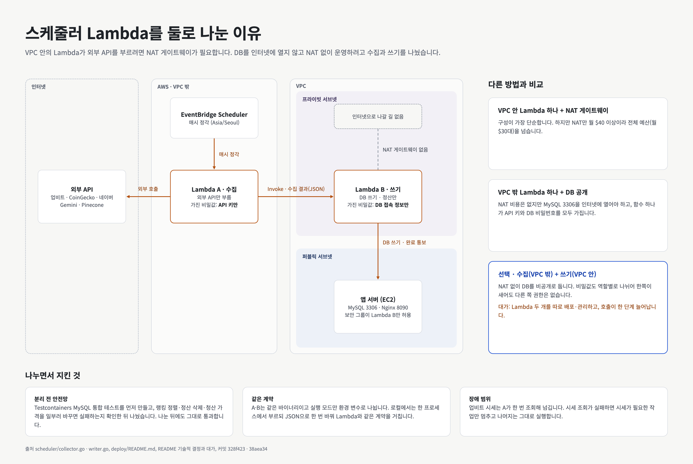

외부 API를 부르는 수집과 DB에 쓰는 쓰기를 나눠, NAT 없이 DB를 비공개로 둡니다. 근거: 커밋 [38aea34](https://github.com/lepe99/bitground/commit/38aea34) · [328f423](https://github.com/lepe99/bitground/commit/328f423)

## v1 대 v2

### 알림 v1 대 v2

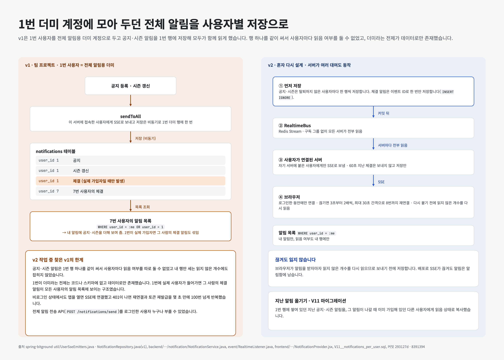

v1은 1번 사용자를 전체 알림용 더미 계정으로 두고 공지·시즌 알림을 그 행에 모았습니다. v2는 사용자별로 저장하고, 사용자가 연결된 서버가 보냅니다. 근거: 커밋 [293127d](https://github.com/lepe99/bitground/commit/293127d) · [8391394](https://github.com/lepe99/bitground/commit/8391394), 테스트 [UserSseEmittersTest](../backend/src/test/java/bit/bitgroundspring/notification/UserSseEmittersTest.java) · [NotificationApiTest](../backend/src/test/java/bit/bitgroundspring/api/NotificationApiTest.java)

### 시즌 정산 v1 대 v2

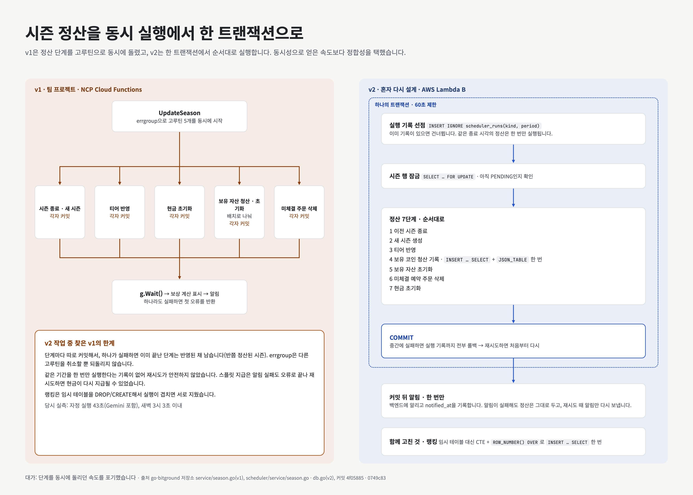

고루틴으로 동시에 돌리던 정산 단계를 한 트랜잭션에서 순서대로 실행하도록 바꿨습니다. 근거: 커밋 [4f05885](https://github.com/lepe99/bitground/commit/4f05885) · [0749c83](https://github.com/lepe99/bitground/commit/0749c83), 테스트 [season_test.go](../scheduler/service/season_test.go)

## 문제 해결

### 부하 테스트 3회

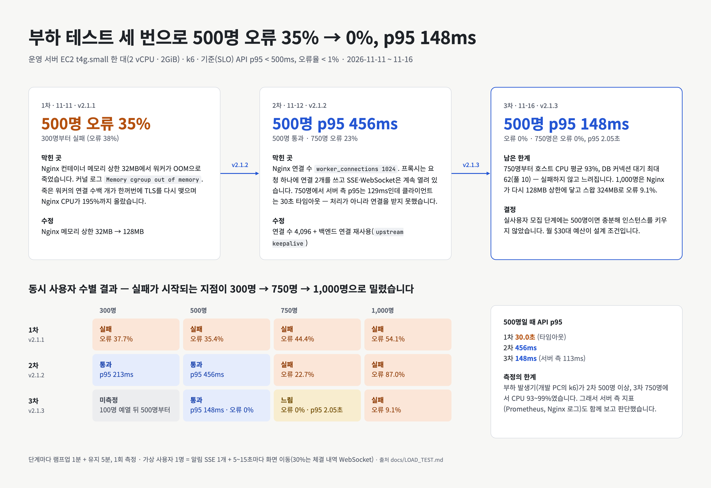

측정 → 원인 → 수정을 세 번 반복해 500명에서 오류 35%를 0%로 줄였습니다. 상세는 [부하 테스트 보고서](LOAD_TEST.md)에 있습니다.

### 데드락 2건

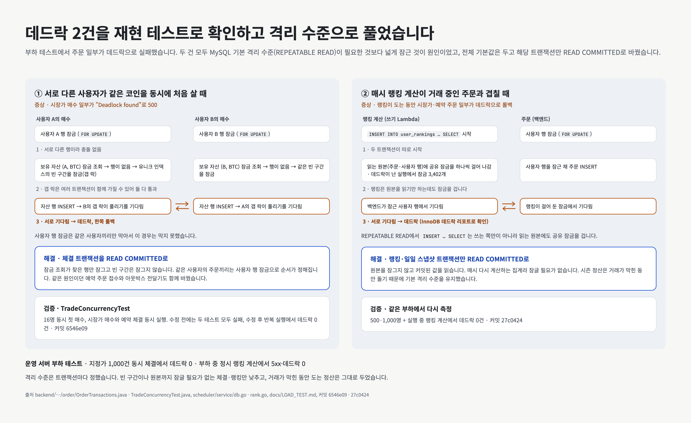

두 건 모두 해당 트랜잭션만 READ COMMITTED로 바꿔 풀었습니다. 근거: 커밋 [6546e09](https://github.com/lepe99/bitground/commit/6546e09) · [27c0424](https://github.com/lepe99/bitground/commit/27c0424), 테스트 [TradeConcurrencyTest](../backend/src/test/java/bit/bitgroundspring/order/TradeConcurrencyTest.java)

## 데이터

### 핵심 테이블 ERD

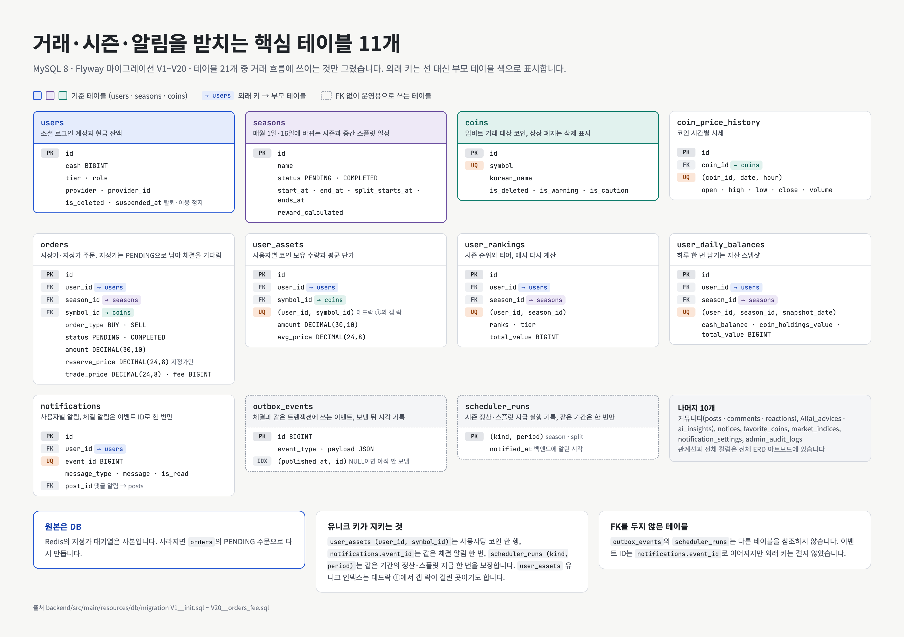

테이블 21개 중 거래·시즌·알림 흐름에 쓰이는 11개와 유니크 키가 지키는 것을 정리했습니다.

### 전체 ERD

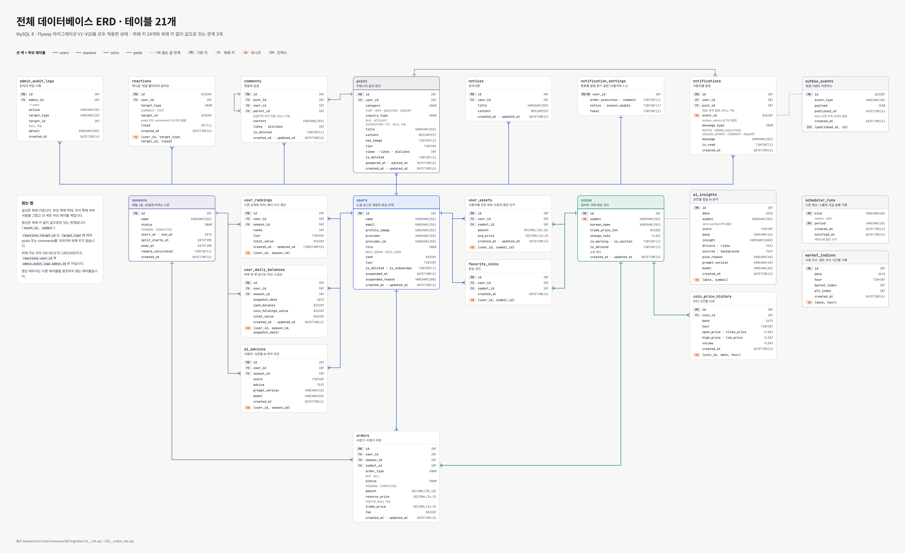

테이블 21개 전부와 컬럼 타입, 외래 키 24개를 그렸습니다. 그림이 커서 눌러서 원본 크기로 보는 편이 좋습니다. 스키마는 [Flyway 마이그레이션](../backend/src/main/resources/db/migration)으로 관리합니다.
