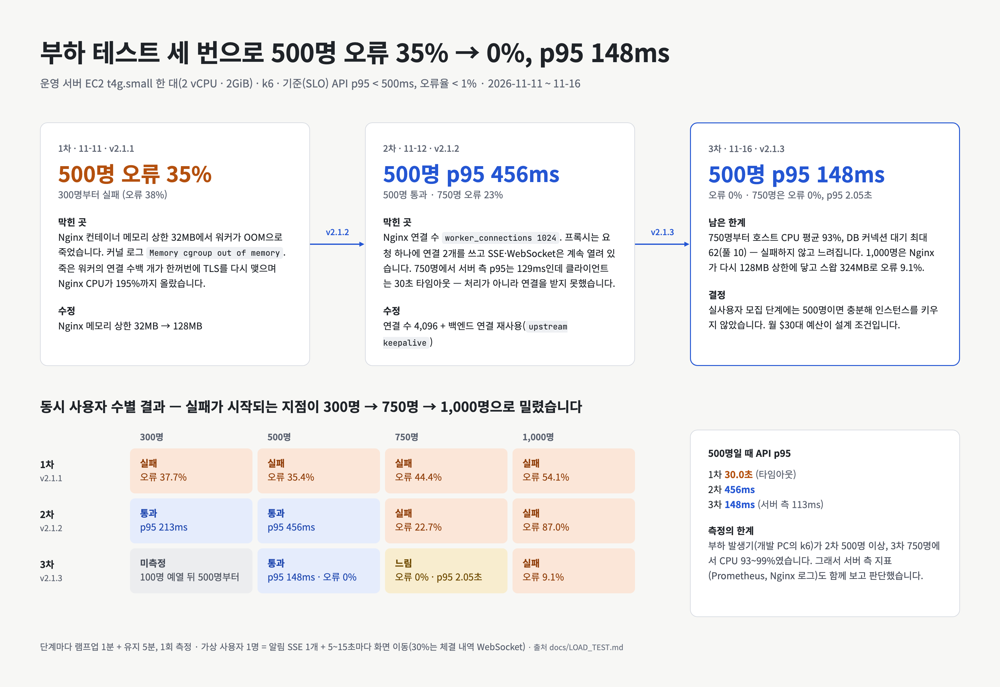
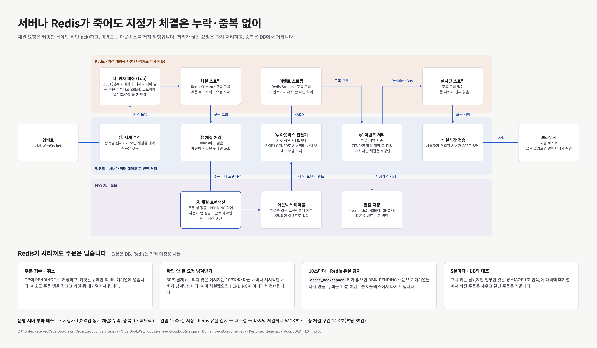
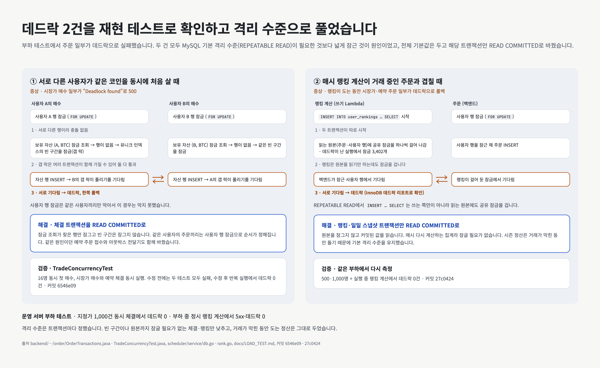
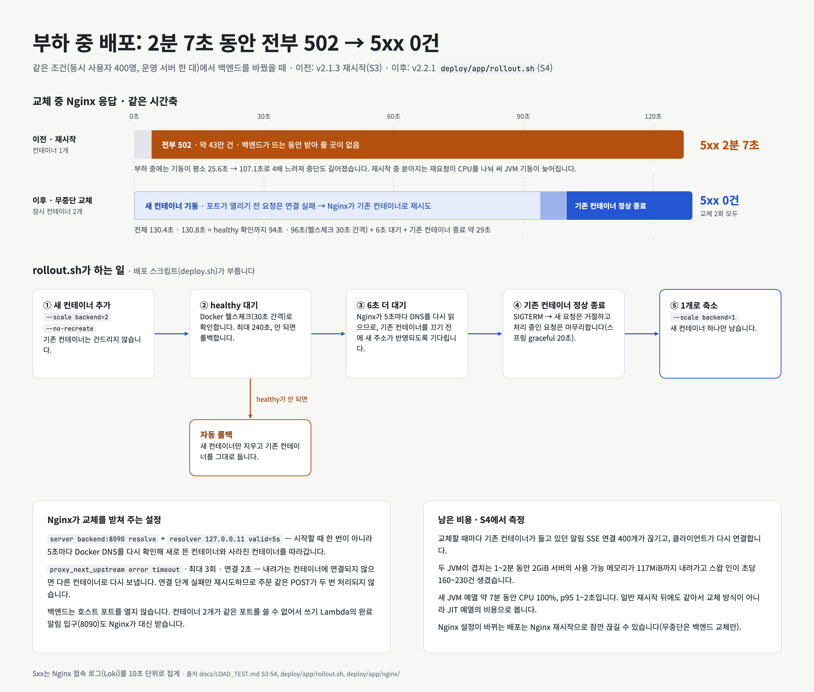

# 부하 테스트 보고서 (v2.1.1 → v2.2.1, 2026-11-11 ~ 11-16)

운영 서버 한 대(EC2 t4g.small)가 몇 명까지 기준을 지키는지, 무엇이 먼저 한계에 닿는지, 지정가 주문이 한꺼번에 체결될 때 정합성이 유지되는지를 측정했습니다.
스크립트와 실행 방법은 [`loadtest/`](../loadtest/README.md)에 있습니다.

## 요약
- **최종(v2.1.3): 동시 사용자 500명까지 여유 있게 기준 통과** (API p95 148ms, 오류 0%). 750명은 오류 없이 처리하지만 p95 2.05초로 기준을 넘습니다 — CPU·DB 커넥션 풀 포화로 **느려질 뿐 실패하지 않습니다.** 1,000명에서는 메모리까지 모자라 실패했습니다(오류 9%).
- 측정 → 원인 → 수정을 세 번 반복했습니다.

| 회차 | 버전 | 300명 | 500명 | 750명 | 막힌 곳 | 수정 |
|---|---|---|---|---|---|---|
| 1차 (11-11) | v2.1.1 | ✗ 오류 38% | ✗ 오류 35% | ✗ | Nginx 메모리 상한 32MB → 워커 OOM (커널 로그) | 128MB (v2.1.2) |
| 2차 (11-12) | v2.1.2 | ✓ p95 213ms | ✓ p95 456ms | ✗ 오류 23% | Nginx 연결 수 `worker_connections 1024` | 4,096 + 백엔드 연결 재사용 (v2.1.3) |
| 3차 (11-16) | v2.1.3 | — | ✓ **p95 148ms** | 오류 0%, p95 2.05s | 호스트 CPU 93%, DB 커넥션 대기 | (현재 규모에선 불필요, 아래 참고) |

- 1차에서 Nginx가 죽는 동안 Grafana도 열리지 않았습니다. Grafana가 앱 서버 Nginx를 거쳐 공개되기 때문입니다(관측 경로가 서비스와 함께 멈춤, [관측성 그림](DIAGRAMS.md#관측성-경로)).
- **부하 중 장애**(400명): Redis 재시작은 오류 0, 정시 랭킹 계산도 오류·데드락 0이었습니다. 하지만 **백엔드 재시작은 2분 7초 동안 전부 502**였습니다(부하 중 기동 107초, 평소 26초) → 단일 컨테이너라 배포 = 중단이었습니다.
- **무중단 배포(v2.2.0~2.2.1) 후 같은 400명 부하에서 교체 2회: Nginx 5xx 0건**이었습니다(이전 2분 7초 502 → 0). 대가는 두 가지입니다 — 교체 순간 기존 컨테이너의 SSE 연결 400개가 끊기고(클라이언트 자동 재연결), 차가운 JVM이 부하를 받는 약 7분 동안 p95가 약 1초로 오릅니다.
- **지정가 1,000건 동시 체결**: 누락·중복 0, 데드락 0, 알림 1,000건 모두 저장됐습니다. Redis 유실 감지 → DB 기준 재구성 → 체결까지 약 23초, 체결 처리량은 초당 69건입니다.

## 측정 조건
| 항목 | 내용 |
|---|---|
| 대상 | `https://api.bitground.kr` (인터넷 → Nginx·TLS → Spring Boot → MySQL·Redis), 운영 서버 EC2 t4g.small(Graviton 2 vCPU, 2GiB, CPU 크레딧 unlimited·잔량 최대) |
| 부하 발생기 | 개발 PC(i7-11700)의 Docker, k6 2.3.0. 서버까지 왕복 약 8ms. HTTP/2 사용 |
| 데이터 | 가상 사용자 1,500명(`provider='loadtest'`), 게시글 40·댓글 200. 끝난 뒤 전부 삭제하고 실제 사용자·스케줄러 수집 데이터 행 수를 시작 전과 비교 |
| 요청 횟수 제한 | 측정 중에만 해제 (사용자당 제한이 섞이면 서버 처리 능력이 아니라 규칙을 재게 됨). 종료 후 복구 확인 |
| 사용자 모델 | 가상 사용자 1명 = 알림 SSE 연결 1개 + 30%는 체결 내역 WebSocket + 5~15초마다 화면 이동. 화면 비율: 홈 25 · 거래 30 · 투자내역 10 · 랭킹 10 · 최신동향 10 · 커뮤니티 10 · 마이페이지 5(%). 거래 화면의 50%는 시장가 1만원 매수, 20%는 지정가 접수 후 취소. 각 화면은 프론트엔드가 처음 열 때 부르는 API를 동시에 호출 |
| 단계 | 램프업 1분 + 유지 5분, 단계 사이 1분 휴식 |
| 기준(SLO) | API p95 < 500ms, 오류율 < 1% |
| 서버 지표 | 운영 모니터링(Alloy → Prometheus, 15~30초 간격)에서 유지 구간만, 컨테이너 자원은 10초 간격 `docker stats` |

## S1 용량 — 3차 (v2.1.3: Nginx 연결 4,096, 백엔드 연결 재사용, TLS 캐시 4MB)
백엔드 재시작 직후 측정이 왜곡되지 않도록 100명으로 먼저 예열했습니다.

| 동시 사용자 | API p50 | API p95 | API p99 | 오류율 | 초당 요청 | 화면 p95 | 판정 |
|---|---|---|---|---|---|---|---|
| 100 (예열) | 17ms | 42ms | 74ms | 0% | 52 | 66ms | ✓ |
| **500** | 30ms | **148ms** | 306ms | **0%** | 258 | 261ms | **✓** |
| 750 | 1.32s | 2.05s | 2.33s | 0% | 321 | 3.54s | ✗ (느림) |
| 1,000 | 4.22s | 30.0s | 30.0s | 9.1% | 232 | 30.0s | ✗ |

| 동시 사용자 | 호스트 CPU 평균/최대 | 서버 측 p95 | DB 커넥션 대기 최대 | Nginx 메모리 최대 | 남은 메모리 최소 / 스왑 | 비고 |
|---|---|---|---|---|---|---|
| 500 | 75% / 86% | 113ms | 31 | 88MB | 355MB / 69MB | 2차 대비 p95 456 → 148ms |
| 750 | 93% / 99% | 511ms | 62 | **128MB(상한)** | 212MB / 93MB | 연결 오류 0 |
| 1,000 | 93% / 100% | 421ms | 65 | 128MB | 132MB / **324MB** | Nginx 워커 1회 OOM(`signal 9`) |

- 연결 수 오류(`worker_connections are not enough`)는 0이 됐습니다. 500명이 빨라진 것은 백엔드 연결 재사용으로 요청마다 TCP 연결을 새로 맺지 않게 된 효과로 봅니다.
- 750명부터는 호스트 CPU와 DB 커넥션 풀(10)이 한계입니다. 처리량은 늘었지만(초당 321건) 대기가 길어져 응답이 느려질 뿐, 연결을 거절하던 2차와 달리 실패하지는 않습니다.
- 1,000명에서는 Nginx가 다시 메모리 상한(128MB)에 닿았고 호스트도 스왑을 300MB 넘게 썼습니다. 2GiB 서버 한 대의 한계입니다.

## S1 용량 — 2차 (Nginx 128MB, v2.1.2)
| 동시 사용자 | API p50 | API p95 | API p99 | 오류율 | 초당 요청 | 화면 p95 | 판정 |
|---|---|---|---|---|---|---|---|
| 200 ※ | 29ms | 24.9s | 30.0s | 6.25% | 71 | 30.0s | ✗ (아래 콜드 스타트) |
| 300 | 22ms | 213ms | 5.8s | 0.05% | 147 | 387ms | ✓ |
| **500** | 46ms | **456ms** | 936ms | **0.02%** | 254 | 794ms | **✓** |
| 750 | 21ms | 337ms | 1.1s | 22.7% | 262 | 30.0s | ✗ |
| 1,000 | 5ms | 437ms | 1.6s | 87.0% | 271 | 30.0s | ✗ |

| 동시 사용자 | 호스트 CPU 평균/최대 | 서버 측 p95 | DB 커넥션 대기 최대 | Nginx 메모리 최대 | Nginx 오류 로그 | 남은 메모리 최소 |
|---|---|---|---|---|---|---|
| 300 | 57% / 81% | 105ms | 0 | 62MB | `worker_connections are not enough` 55회 | 356MB |
| 500 | 80% / 90% | 238ms | 68 | 87MB | 같은 경고 20회 | 267MB |
| 750 | 72% / 98% | 129ms | 59 | 95MB | 656회 | 251MB |
| 1,000 | — | — | — | 94MB | **18,849회** | — |

- 750명부터의 실패는 서버 처리 시간이 아니라 연결을 받지 못해서 생깁니다. 서버 측 p95는 129ms인데 클라이언트에서는 30초 타임아웃이 나고, 처리량(초당 요청)이 500명 이후 더 늘지 않습니다.
- 데드락 0, OOM 0, 백엔드 오류 로그 0이었습니다.
- ※ 200명 단계는 준비 스크립트가 백엔드를 재시작한 직후 첫 단계로 실행됐습니다. JIT 컴파일 전인 JVM에 1분 만에 TLS 연결 약 1,500개가 몰려 호스트 CPU 97%, load average 10, TLS 핸드셰이크 10~14초가 관측됐습니다. 1차 측정(50·100명을 먼저 거쳐 데운 상태)에서 200명은 p95 40ms였습니다.

## S1 용량 — 1차 (Nginx 32MB, v2.1.1)
| 동시 사용자 | API p95 | 오류율 | 초당 요청 | Nginx 메모리 최대 | Nginx CPU 최대 |
|---|---|---|---|---|---|
| 50 | 35ms | 0% | 26 | — | — |
| 100 | 31ms | 0% | 52 | — | — |
| 200 | 40ms | 0% | 104 | **32MB(상한)** | 8% |
| 300 | 30.0s | 37.7% | 60 | 32MB | **195%** |
| 500 | 30.0s | 35.4% | 124 | 32MB | 193% |
| 750 | 26.9s | 44.4% | 145 | 32MB | — |
| 1,000 | 30.0s | 54.1% | 176 | 32MB | 51% |

- 클라이언트 오류: `connect: connection refused`(443), `EOF`, 30초 타임아웃
- 커널 로그: `Memory cgroup out of memory: Killed process (nginx)` (17:23, 17:25, 17:26 …). 워커가 죽으면 그 워커의 모든 연결이 끊기고 수백 명이 동시에 TLS를 다시 맺으면서 Nginx가 CPU 2코어를 다 썼습니다.
- 같은 시간 `grafana.bitground.kr`도 열리지 않았습니다(Grafana 정적 파일 `ChunkLoadError` 타임아웃). 지표 수집(Alloy → Prometheus)은 끊기지 않아 이 보고서의 서버 지표는 그대로 남았습니다.

## S2 지정가 체결 버스트
가상 사용자 1,000명이 BTC 매수 지정가를 현재가보다 2% 높게 걸어 둔 상태(DB PENDING)를 만들고, Redis 대기열 표시 키(`order_book:epoch`)를 지웠습니다. 서버는 10초마다 이 키를 확인해 없으면 Redis 유실로 판단하고 DB 기준으로 대기열을 다시 만듭니다. 다음 시세에서 1,000건이 동시에 체결 조건을 만족합니다.

| 항목 | 결과 |
|---|---|
| 유실 감지 → 재구성 | 7.8초 (확인 주기 10초 안) — `rebuilt from DB (1070 pending orders)` |
| 재구성 → 첫 체결 | 0.3초 |
| 첫 체결 → 마지막 체결 | 14.4초 (**초당 69건**) |
| 체결 / 대기 남음 | 1,000 / 0 |
| 체결가 | 지정가가 아닌 당시 시세(99,850,000~99,880,000원) |
| 알림 | 1,000건, 사용자 1,000명 (중복 없음) |
| 아웃박스 미전달 · 체결 스트림 대기 | 0 · 0 |
| 데드락 | 0 (서로 다른 사용자의 첫 매수가 몰리는 조건, `6546e09` 수정 회귀 확인) |

이 측정 전에 고친 데드락 2건(동시 첫 매수의 갭 락, 랭킹 계산과 주문의 공유 잠금)은 아래와 같습니다.

## S3 부하 중 장애·정시 작업 (v2.1.3, 2026-11-16)
동시 사용자 400명(3분 램프업 + 43분 유지) 부하를 건 채로 정해진 시각에 사건을 일으켰습니다. 구간별 응답은 Nginx 접속 로그(Loki)를 10초 단위로 집계했습니다.

| 시각 | 사건 | 결과 |
|---|---|---|
| 10:31:06 | **Redis 재시작** | 5xx **0건**, 10초당 요청 수 변화 없음. 요청 횟수 제한·캐시는 Redis 장애 시 DB로 넘어가도록 만든 설계대로 동작 |
| 10:39:06 | **백엔드 재시작** | **약 2분 7초 동안 전부 502** (10:39:10 ~ 10:41:13, Nginx 502 약 43만 건). 기동 시간이 평소 **25.6초 → 부하 중 107.1초**. 백엔드가 뜨자 대기열 재구성 후 10초 안에 정상 응답으로 복귀 |
| 11:00 | **정시 스케줄러**(랭킹 계산, Lambda) | 5xx 0건, 데드락 0. 쓰기 Lambda 실행 시간 평소 0.7~0.95초 → 3.58초(랭킹 2.2초, 랭킹 대상이 가상 사용자 1,500명으로 늘어난 영향 포함). 그 분의 최대 요청 시간 1.75초(평소 약 0.3초) |

- 전체 46분: 요청 약 103만 건, API p95 842ms, 오류율 4.5% — 오류는 거의 전부 백엔드 재시작 구간의 502입니다.
- **백엔드 재시작 = 서비스 중단**입니다. 컨테이너가 하나뿐이라 재시작(배포 포함) 동안 받아 줄 곳이 없습니다. 부하 중에는 기동이 4배 느려져 중단이 길어집니다.
  - k6 가상 사용자는 502를 받으면 쉬지 않고 바로 다시 요청해 10초당 약 4만 건(평소의 17배)을 보냈습니다. 실제 브라우저는 SSE를 지수 백오프로 재연결하므로 이보다 덜하지만, 재시작 중 쏟아지는 요청이 CPU를 나눠 써서 JVM 기동을 늦추는 구조는 같습니다.
  - 개선 방향: 배포 때 새 컨테이너를 먼저 띄우고 준비되면 Nginx가 넘겨 받는 방식(블루·그린 / 두 컨테이너 순차 교체), 재시작 동안 Nginx가 502 대신 짧은 점검 응답과 `Retry-After`를 주는 방식이 있습니다.
- 측정 도구 쪽 발견: 장애 주입 스크립트가 컨테이너 health 상태를 보고 "6초 만에 healthy"로 기록했지만 실제로는 2분이었습니다. Docker health 검사가 30초 간격이라 재시작 직후에도 이전 상태(healthy)가 남아 있었습니다 → readiness 엔드포인트를 직접 확인하도록 고쳤습니다.
- Redis 재시작 시점에 DB의 미체결 지정가 주문이 0건이라 대기열 재구성은 의미 있게 검증되지 않았습니다. 재구성 경로는 S2(1,000건)에서 검증했습니다.

## S4 부하 중 무중단 배포 (v2.2.1, 2026-11-16)
S3에서 확인한 "배포 = 중단"을 고친 뒤 같은 조건(동시 400명, 램프업 2분 + 유지 14분)에서 운영 배포와 같은 교체(`deploy/app/rollout.sh`)를 두 번 실행했습니다.

**교체 방식**: 새 백엔드 컨테이너를 하나 더 띄움 → readiness가 UP이면 Nginx가 DNS(5초 갱신)로 새 컨테이너를 찾음 → 6초 뒤 기존 컨테이너를 graceful shutdown(진행 중 요청 마무리, 최대 20초) → 1개로 축소합니다. 새 컨테이너가 준비되지 않으면 새 것만 지우고 기존 것을 유지합니다. Nginx는 연결 실패·시간 초과 시 다른 컨테이너로 최대 3번 재시도합니다.

| 항목 | S3 백엔드 재시작 (v2.1.3) | **S4 무중단 교체 (v2.2.1)** ×2 |
|---|---|---|
| Nginx 5xx | 약 2분 7초 전부 502 (약 43만 건) | **0건, 0건** (499도 0) |
| 교체 전체 시간 | 기동 107초 | 130.4초, 130.8초 (새 컨테이너 healthy까지 94초·96초, 기존 종료 약 29초) |
| 끊긴 연결 | 전부 | **SSE 400개**(교체마다, 기존 컨테이너가 들고 있던 알림 스트림). HTTP/2 `INTERNAL_ERROR`로 끊긴 뒤 다시 연결됨(그 10초 SSE 요청 465·566건) |
| 백엔드 ERROR 로그 | — | 0, 0 |

분 단위 서버 지표(Prometheus):

| 시각 | 사건 | API p95 | 호스트 CPU | 사용 가능 메모리 | 스왑 사용 | 스왑 인/초 | DB 커넥션 대기 |
|---|---|---|---|---|---|---|---|
| 13:56~13:59 | 정상 | 44~64ms | 64~77% | 415MiB | 134MiB | 0 | 0 |
| 14:00~14:01 | 1차 교체(두 JVM 공존) | 378~889ms | 100% | **117MiB** | 355MiB | 161 | 0 |
| 14:02~14:05 | 새 JVM 예열 중 | 1.0~2.0s | 99~100% | 460~530MiB | 300MiB | 5~376 | **53~60** |
| 14:06~14:08 | 2차 교체 | 1.6~2.2s | 100% | 117MiB | 413MiB | 169~233 | 58 |

- **끊김은 없어졌지만 느려지는 구간이 생깁니다.** 원인은 두 가지입니다.
  1. **두 JVM이 겹치는 1~2분**: 2GiB 서버에 백엔드가 2개 떠서 사용 가능 메모리가 117MiB까지 내려가고 스왑 인·주 페이지 폴트가 초당 수백 건 생겼습니다. 새 JVM 기동이 같은 2 vCPU를 나눠 써서 전환 전부터 처리량이 약 35% 줄었습니다.
  2. **차가운 JVM이 부하를 받는 약 7분**: 전환 뒤 CPU 100%·DB 커넥션 대기 50~60이 이어집니다. S3 재시작 뒤에도 똑같이 10:42 → 10:49 약 7분 동안 p95 1~1.8초였다가 48ms로 돌아왔습니다 → 교체 방식이 아니라 JIT 예열의 비용입니다. 이번 2차 교체는 1차 전환 4분 뒤라 예열이 끝나기 전에 다시 교체했습니다.
- k6 전체 수치(API p95 6.41s, 오류 2.93%)는 판단에 쓰지 않았습니다. 오류 5,152건은 SSE 800건 + 테스트 데이터 문제(앞선 정리에서 지운 게시글 번호를 그대로 써서 생긴 404 약 4,700건)이고, 발생기 CPU도 94%였습니다. 서버 판단은 Nginx 로그·Prometheus로 했습니다.
- 개선 후보(미적용): 전환 전에 새 컨테이너로 예열 요청 보내기 / 트래픽이 적은 시간 배포 / 기동 시간 단축(AppCDS·CRaC) / 종료 전에 SSE 클라이언트에 재연결 안내 이벤트 보내기 / 겹치는 동안의 메모리를 위해 힙 상한 조정이 있습니다.
- 한계: Nginx 설정이 바뀌는 배포는 Nginx 재시작으로 짧게 끊길 수 있습니다(백엔드 교체만 무중단).

## 병목과 다음 조치
| 병목 | 근거 | 상태 / 조치 후보 |
|---|---|---|
| Nginx 메모리 | 1차: 32MB에서 워커 OOM | ✅ 128MB (v2.1.2). 1,000명에선 다시 상한 |
| Nginx 연결 수 | 2차: `1024 worker_connections are not enough` 최대 18,849회. 프록시는 요청당 클라이언트·백엔드 연결 2개, SSE·WebSocket은 계속 열려 있음 | ✅ 4,096 + `upstream keepalive` (v2.1.3) |
| 호스트 CPU | 3차: 750명 평균 93% | 남은 한계. 인스턴스 크기(t4g.medium 등)가 다음 단계 |
| DB 커넥션 풀 | 3차: 750명 대기 최대 62 (풀 10) | 남은 한계. CPU가 같이 포화라 풀만 늘리면 경합만 커질 수 있음 → 느린 쿼리 확인이 먼저 |
| 기동 직후 | 2차: 재시작 직후 200명에서 TLS 10초·CPU 97% | 배포 직후 예열, 점진적 트래픽 |
| 단일 백엔드 컨테이너 | S3: 재시작 중 2분 7초 전부 502, 부하 중 기동 107초 | ✅ 무중단 교체 (v2.2.0~2.2.1, S4: 5xx 0). 남은 비용: SSE 재연결, 겹치는 동안 메모리 부족, 약 7분 JIT 예열 |
| 관측 경로 | 1·2차: Grafana가 앱 서버 Nginx를 거쳐 서비스와 함께 불가 | SSM 포트 포워딩으로 모니터링 서버 직접 접속, 앱 서버를 거치지 않는 경보(CloudWatch → SNS) |

현재 서비스 규모(실사용자 모집 단계)에서는 동시 500명이 충분하므로 인스턴스를 키우지 않습니다. 비용 상한(월 $30대)이 설계 조건입니다.

## 한계
- **부하 발생기 포화**: 2차 500명 이상, 3차 750명에서 개발 PC의 k6 컨테이너 CPU가 93~99%였습니다. 그 단계의 클라이언트 응답 시간에는 발생기 지연이 섞였을 수 있습니다. 그래서 판단은 서버 측 지표(Prometheus p95, CPU, 커넥션 대기, Nginx 로그)와 함께 했습니다.
- **연결 수 모델**: k6는 SSE·화면 이동·WebSocket을 서로 다른 VU로 실행해 사용자당 연결을 따로 엽니다. 실제 브라우저는 HTTP/2 연결 하나로 API와 SSE를 함께 보내므로 같은 Nginx 설정에서 더 많은 사용자를 받을 수 있습니다.
- **사용자 행동은 가정**입니다(화면 비율·머무는 시간). 실사용자 지표로 보정이 필요합니다.
- 각 단계를 1회씩 측정했습니다. 2차 200명·1,000명 단계는 Prometheus 조회가 실패해 서버 지표가 빠졌습니다.
- S4는 게시글 시드를 다시 만들지 않아 커뮤니티 화면 요청 일부가 404였습니다(서버 판단엔 영향 없음, 위 S4 참고).
- 지속(소크) 테스트, CPU 크레딧 소진 상태 측정은 하지 않았습니다.
